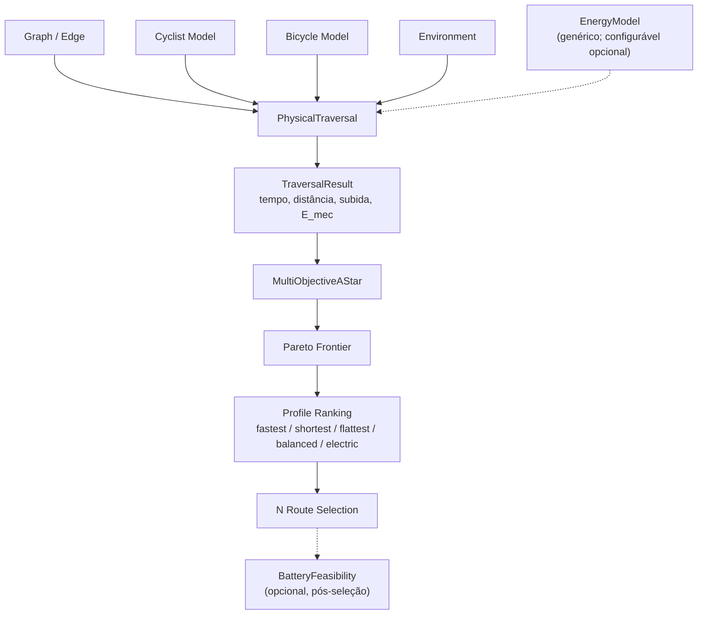

# Perfil Elétrico — especificação

> **Status:** **implementado**. O perfil genérico `Elétrico` (id `electric`), o
> modelo energético (`EnergyModel`) e a viabilidade de bateria opcional
> (`BatteryFeasibility`) estão na engine. Ver a seção **8. Implementação** para
> o mapeamento entre esta especificação e o código.
>
> Regra de ouro deste documento: **perfil de roteamento** e **modelo energético**
> são coisas separadas. O usuário escolhe o que otimizar; a estimativa de
> consumo é feita por um modelo que pode ter mais ou menos informação — mas
> nunca é pré-requisito para calcular a rota.

## 1. Como fica para o usuário

Lista de perfis (adiciona-se o quinto):

| Perfil | Prioriza |
| --- | --- |
| Mais rápido | tempo de viagem |
| Mais curto | distância |
| Mais plano | evita subidas |
| Equilibrado | combina tempo, distância e subida |
| **Elétrico** | **economia de energia e autonomia** |

O usuário seleciona `Elétrico` e pronto. **Não** precisa informar:

- marca;
- modelo;
- capacidade da bateria;
- potência do motor;
- fabricante;
- tipo de veículo.

Essas informações podem ser **opcionais** (melhoram a estimativa), mas **não
devem ser requisito** para calcular a rota.

## 2. Mudança de arquitetura

Antes, o perfil elétrico dependia de um modelo específico de e-bike. Agora o
perfil deixa de depender de um veículo concreto.

```
RoutingProfile
    ├── Fastest
    ├── Shortest
    ├── Flattest
    ├── Balanced
    └── Electric
```

E o modelo de energia é separado:

```
RoutingEngine
    │
    ├── RoutingProfile
    │
    ├── PhysicalTraversal
    │
    └── EnergyModel
          ├── GenericEnergyModel
          └── ConfiguredEnergyModel (opcional)
```

- O `Electric` diz ao motor: *"quero uma rota que favoreça autonomia e consumo
  elétrico"*.
- O `EnergyModel` diz: *"como estimar a energia necessária para percorrer cada
  trecho?"*.

O perfil **não** precisa saber qual veículo está sendo usado.

### 2.1 Onde entra no diagrama (o antigo → o novo)

O diagrama antigo tinha, como entradas do `PhysicalTraversal`:
`Graph/Edge`, `Cyclist Model`, `Bicycle Model`, `Environment`, **`E-bike Model`**
e **`Battery Model`**. Esse diagrama é **antigo** (pensado para e-bike) e fica
substituído assim:

- **`E-bike Model` sai** e entra o **`EnergyModel` genérico** (opcionalmente
  configurado). É **aqui, na linha de entradas do `PhysicalTraversal`**, que o
  `EnergyModel` deve ser inserido.
- **`Battery Model` deixa de ser entrada** do traversal físico. Vira um estágio
  **opcional e posterior** (`BatteryFeasibility`), só quando existir bateria
  configurada — ele não participa da física nem da fronteira Pareto.



- O `EnergyModel` recebe a energia **mecânica** (`E_mec`) do `TraversalResult` e
  fornece a estimativa de energia **elétrica** (`E_elétrica ≈ E_mec / η`) usada
  como objetivo $E$ do perfil `Elétrico`.
- Sem `EnergyModel` configurado, usa-se o genérico (valores de referência
  internos); a linha é a mesma.
- O restante do fluxo (`MultiObjectiveAStar → Pareto → Profile Ranking →
  N Route Selection`) **não muda**; só ganha o perfil `electric`.

## 3. Como calcular energia sem conhecer o veículo

Modelo energético **genérico**, baseado na física do movimento. Para cada
segmento, calcular:

- distância;
- inclinação;
- velocidade;
- aceleração;
- resistência ao rolamento;
- resistência aerodinâmica;
- energia necessária para vencer a gravidade.

Energia mecânica estimada:

$$E_{mec} = \int P_{mec}(t)\,dt$$

Conversão para energia elétrica (requer assumir uma eficiência η):

$$E_{elétrica} \approx \frac{E_{mec}}{\eta}$$

> **Problema:** sem conhecer motor, bateria, assistência ou veículo, **não existe
> estimativa universalmente correta** de Wh consumidos. Por isso o modelo
> genérico usa parâmetros de referência internos.

### 3.1 Modo genérico

Usa parâmetros padrão e calcula um consumo aproximado. Esses parâmetros são
internos ao modelo e **não aparecem na interface**.

```python
@dataclass(frozen=True)
class GenericEnergyConfig:
    mass_kg: float
    rolling_resistance: float
    drag_coefficient: float
    frontal_area_m2: float
    drivetrain_efficiency: float
```

### 3.2 Modo configurado

Se o usuário, no futuro, cadastrar o veículo, o sistema pode usar:

- massa real;
- capacidade da bateria;
- eficiência;
- potência;
- nível de assistência.

Isso melhora a estimativa, mas o perfil **continua** sendo `Elétrico`.

## 4. Quando nem a massa do veículo é conhecida

Três níveis de estimativa (o perfil é o mesmo em todos):

| Nível | Dados usados | Resultado |
| --- | --- | --- |
| **Genérico** | valores padrão do modelo | consumo aproximado |
| **Personalizado** | massa, assistência e bateria configuradas | estimativa mais específica |
| **Calibrado** | dados reais de viagens anteriores | estimativa ajustada ao usuário |

**Não invente uma bateria de 500 Wh para todos.** A bateria pode simplesmente
não ser conhecida. Nesse caso o sistema calcula a energia estimada por rota,
mas **não** apresenta autonomia restante nem percentual de bateria.

## 5. Pareto do perfil elétrico

Dois objetivos:

$$\boxed{\min(E, T)}$$

- $E$: energia estimada.
- $T$: tempo estimado.

Sem veículo configurado, $E$ é uma estimativa genérica — o algoritmo **não
muda**:

```
Electric Profile
      ↓
MultiObjective A*
      ↓
EnergyModel
      ↓
Pareto Frontier
      ↓
RouteSelector
```

O que muda é o **significado** do resultado:

| Rota | Energia estimada | Tempo |
| --- | --- | --- |
| A | 120 Wh | 35 min |
| B | 95 Wh | 45 min |
| C | 105 Wh | 40 min |

O sistema pode apresentar **B** como a opção de menor consumo estimado — mas
**não** pode afirmar que B consumirá exatamente 95 Wh na realidade.

## 6. "Consigo chegar ao destino?" é separado

O perfil `Elétrico` funciona **sem** bateria cadastrada. Mas para afirmar *"você
consegue chegar com a bateria atual"*, o sistema precisa conhecer:

- energia disponível;
- consumo estimado da rota;
- reserva desejada.

```
ElectricRoutingProfile
    ├── Energy optimization
    ├── Time optimization
    └── Generic energy estimation

BatteryFeasibility (opcional)
    ├── Available energy
    ├── Estimated route consumption
    └── Reserve energy
```

Assim, o usuário **não** é obrigado a configurar bateria para usar o perfil.

## 7. Recomendação de implementação

```python
class RoutingProfile(Enum):
    FASTEST = ...
    SHORTEST = ...
    FLATTEST = ...
    BALANCED = ...
    ELECTRIC = ...
```

```python
@dataclass(frozen=True)
class RoutingRequest:
    profile: RoutingProfile
    energy_model: EnergyModelConfig | None = None
    battery: BatteryConfig | None = None
```

Comportamento padrão (sem veículo, sem bateria):

```
profile      = ELECTRIC
energy_model = modelo genérico (padrão)
battery      = None
```

Resultado: calcula consumo estimado; otimiza energia e tempo; **não** exige
veículo, bateria, marca ou modelo; **não** promete autonomia restante.

Com bateria configurada:

```
profile      = ELECTRIC
energy_model = modelo configurado
battery      = bateria configurada
```

Habilita também: percentual estimado na chegada, autonomia restante,
viabilidade da rota e alerta de bateria insuficiente.

### Decisão de nome

Chamar o perfil de **`Elétrico`** — **não** `E-bike Autonomia`, que limitaria o
produto a bicicletas elétricas. Internamente usa-se um modelo genérico de
consumo elétrico; no futuro podem entrar outros veículos elétricos sem alterar o
perfil de roteamento.

### Ressalva importante

Se o grafo e os parâmetros físicos forem especificamente **ciclísticos**, o
perfil continuará sendo ciclístico na prática. O nome genérico **não** torna o
roteador compatível com carros, scooters ou outros veículos — isso exigiria
modelos físicos e restrições de rede próprios.

## Resumo

Perfil **genérico**, modelo energético **genérico**, **veículo opcional** e
**bateria opcional**. O perfil define *o que otimizar*; o `EnergyModel` define
*como estimar o consumo*; a viabilidade de bateria é um recurso **separado**.

## 8. Implementação

| Conceito | Onde está |
| --- | --- |
| Perfil `Elétrico` (id `electric`) | `src/search/profiles.py` (`PROFILE_CONFIG["electric"]`), `src/search/objectives.py` (`PROFILE_OBJECTIVES["electric"]`) |
| Objetivos Pareto | `(Objective.ENERGY, Objective.TIME)` → `("energy_j", "time_s")` |
| Ranking | lexicográfico (energia primeiro) com tolerância `energy_j`/`time_s` |
| Modelo energético | `src/physical/energy_model.py`: `GenericEnergyConfig`, `EnergyModel`, `EnergyEstimate` |
| Bateria opcional | `BatteryConfig`, `BatteryFeasibility`, `assess_battery` |
| Estimativa por rota | `src/search/energy.py`: `RouteEnergyEstimate`, `estimate_route_energy(s)` |
| Integração | `ProfileSearchRequest(energy_model=..., battery=...)` → `ProfileSearchResponse.energy` |
| GUI | `gui/routegui/app.py` (perfil "Eletrico" + coluna de energia), `engine_bridge.py` (`GuiRoute.energy_wh`/`battery_note`) |

Notas de implementação:

- O perfil **não** muda a física nem a fronteira: o search usa os objetivos
  Pareto de sempre. A energia acumulada na rota é **mecânica**
  (`SearchState.energy_j`); como a conversão para elétrica é um fator constante
  (`1/η`), a ordenação de Pareto é idêntica.
- A conversão para energia **elétrica** (`E_elétrica ≈ E_mec / η`) e a
  viabilidade de bateria acontecem **após** a seleção (`search_profile`), e só
  quando o perfil usa energia, há modelo configurado ou bateria informada. Para
  os demais perfis, `ProfileSearchResponse.energy == ()`.
- Sem bateria configurada: calcula-se a energia estimada (Wh), mas **não** há
  autonomia nem percentual (`RouteEnergyEstimate.battery is None`).
- Nível da estimativa: `EnergyModel.generic()` (padrão) ou
  `EnergyModel.configured(config, level=...)` — `personalized`/`calibrated`.
  O perfil é o mesmo em todos os níveis.
